# SensorGuard: trusted in-situ weather data

**TSYP14 technical challenge "Ground Truth Under Attack: Securing the Earth Observation Chain", Track 2: False Data Injection, in-situ sensing.**

Field weather stations are the *ground truth* of Earth observation. Irrigation advice, drought monitoring, index-based crop insurance and the calibration of satellite products all rest on what they report. An attacker who falsifies a station (a small bias, a slow drift, a week of old data played again) can make a decision go the way they want, and nothing in the data looks wrong.

SensorGuard keeps a falsified reading from silently driving a decision:

1. **It proves where each reading came from.** Every reading is signed by its station and chained into a tamper-evident ledger.
2. **It checks each station against an independent witness.** NASA POWER gives a daily reference for the same place and day, which no ground attacker can touch. Real weather moves both together; a falsified station drifts away from it.
3. **It gives each station a trust score** (a calibrated compromise probability per day, turned into a trust level), and **responds in four graded steps**: de-weighting, verification request, quarantine, alert.

It runs on any station series plus its coordinates (the jury's hidden site included), from a [graphical control room](#3-the-control-room-gui) or [the command line](#4-file-mode-from-the-command-line).

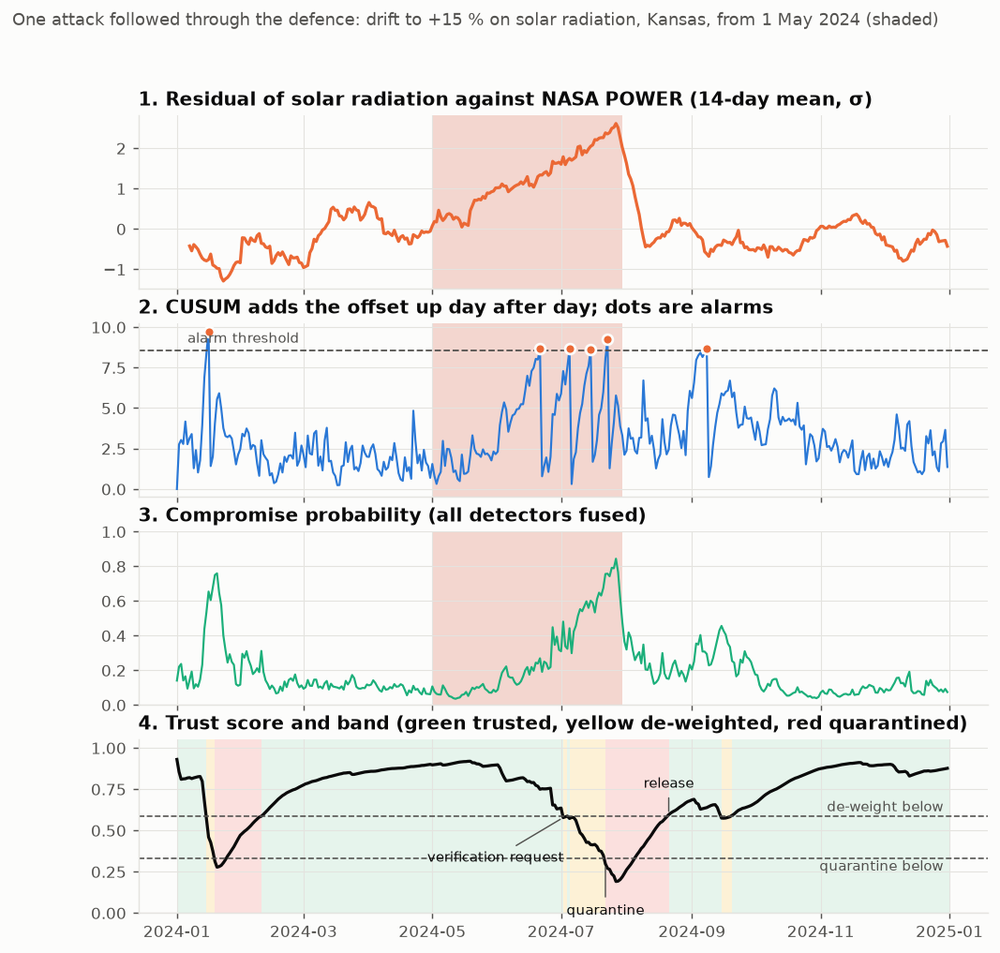

*A drift to +15 % on solar radiation at Kansas from 1 May 2024 (shaded): the gap grows, CUSUM alarms, the probability rises, trust falls into quarantine and recovers after the attack. The quarantine in January, before the attack, is a false alarm on the clean data (a natural week-long humidity gap).*

---

## Contents

1. [How it works](#1-how-it-works)
2. [Results](#2-results)
3. [The control room (GUI)](#3-the-control-room-gui)
4. [File mode from the command line](#4-file-mode-from-the-command-line)
5. [Install and reproduce](#5-install-and-reproduce)
6. [Repository layout](#6-repository-layout)
7. [Documentation](#7-documentation)
8. [Limits](#8-limits)

---

## 1. How it works

### 1.1 The threat: the three official attacks

The challenge's standard test injects three attacks into a real series. They are small on purpose: a 12 % bias is about the size of the normal difference between a point station and a 50 km reference grid, so no single day gives it away.

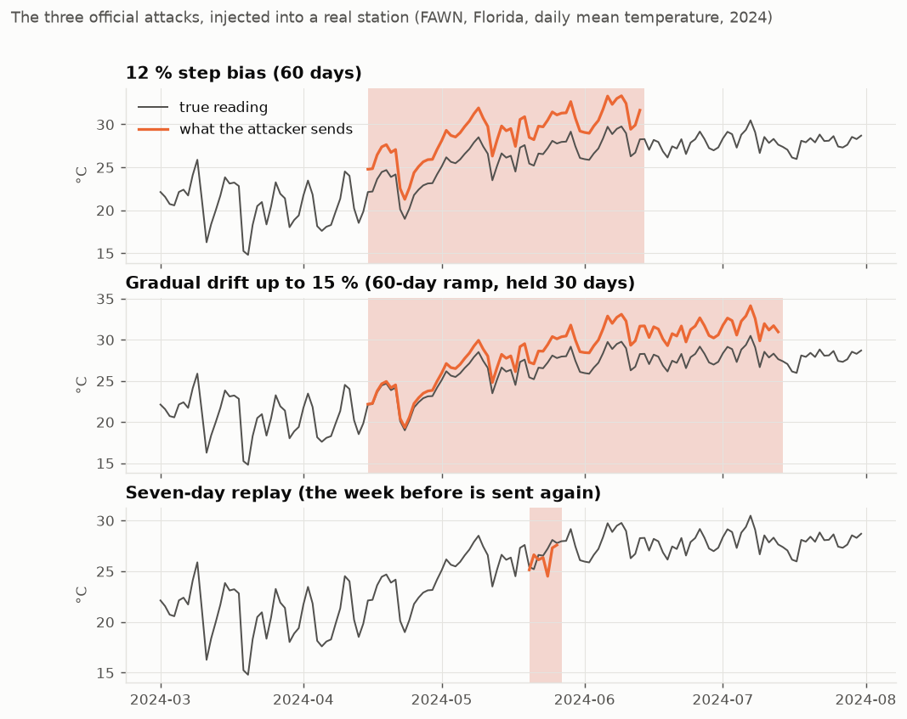

| Attack | What the attacker does | Why it is hard |
|---|---|---|
| **Step bias** | from one day on, every value is pushed up or down by 12 % | each day still looks like plausible weather |
| **Gradual drift** | the offset grows from 0 to 15 % over 30 to 90 days, then holds | looks like sensor ageing or a warm spell |
| **Replay** | seven days of the station's own earlier readings are sent again | every value is genuine; only the date is a lie |

The organizers have not said what "12 %" is relative to, so every attack is run three ways: 12 % **of the value**, **of the variable's range**, **of its standard deviation**.

### 1.2 Where the attacker sits, and which layer stops them

| Position | Attacker | What stops it |
|---|---|---|
| **P2**, on the telemetry link | has no station key | **Layer 1, provenance:** each record is signed with the station's Ed25519 key; a modified record fails its signature, a replayed one fails the sequence check |
| **P3**, inside the data pipeline | rewrites stored records after verification | **Layer 1:** the hash-chained ledger breaks at the first rewritten entry |
| **P1**, at the station (or a stolen key) | signs the false values itself | **Layers 2 and 3, detection:** the data is validly signed, so only its *content* can betray it. This is the hard case, and the case the jury tests |

### 1.3 The pipeline

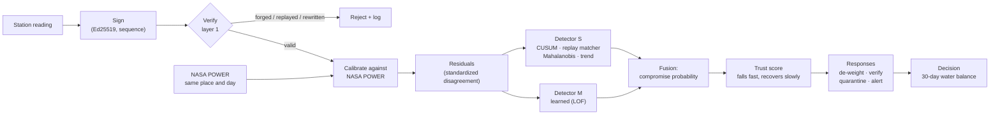

### 1.4 Detect disagreement, not extremes

A heatwave is extreme and genuine; a 12 % bias is ordinary-looking and false. So the system never asks "is this value unusual?" but **"does the station still agree with an independent witness?"**

For each variable the station is compared with NASA POWER for the same place and day. The calibration learns, season by season on the training years, the normal offset between the point station and the 50 km grid cell. The **standardized residual** is the station minus the calibrated reference, divided by its usual spread.

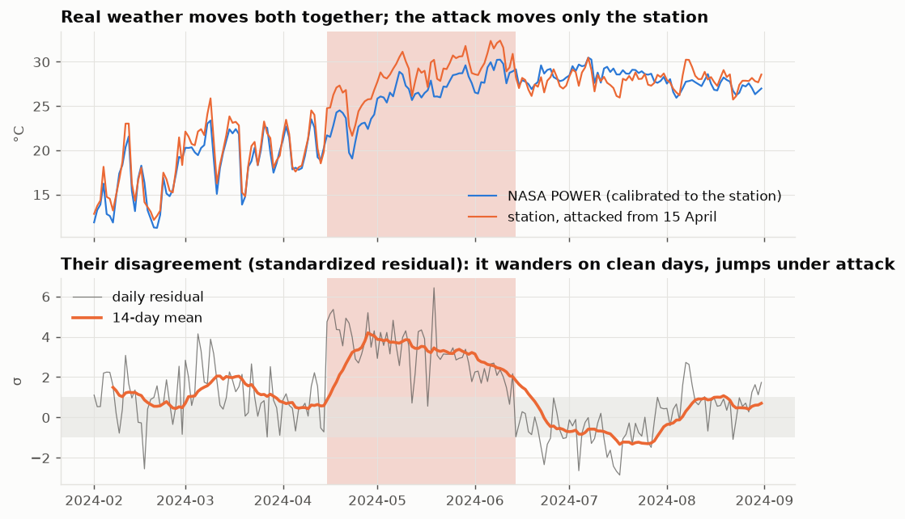

In real weather the two move together and the residual wanders around zero. It does wander, by up to about ±1 σ for weeks, because a point and a 50 km cell do not see the same weather. Under attack it jumps and stays off.

### 1.5 The detectors

| Detector | What it catches | How |
|---|---|---|
| **CUSUM** | a lasting offset (step, drift) | adds up every day's disagreement beyond a small allowance. Noise cancels out; a lasting 12 % does not. It restarts after each alarm and dates the change back to when the sum started growing |
| **Replay matcher** | a replayed week | compares every 7-day window of the station's own values with every earlier window (lags 1 to 730 days). A copy has distance zero; real weather never repeats a week across four variables |
| **Mahalanobis** | one unusual day | how far today's combination of residuals is from normal, across variables |
| **Trend** | a slow drift | rolling Mann-Kendall test on the residuals (reported, not used in the combined alarm) |
| **Detector M** | anything unusual, learned | a one-class model (LOF) on 30-day residual windows, trained on clean data only |

Every threshold is set from a **false-alarm budget on the clean training years** (at most 1 alarm per year), not guessed. This matters because the final test site is hidden: each site gets the threshold its own noise requires.

### 1.6 From detectors to a trust score and four responses

- **Compromise probability.** The detector outputs are fused by a logistic regression into one number per day: the probability that today's reading is falsified. It is learned from the 756 simulated attacks. It is **calibrated**: of the days it scores 0.3, about 30 % really were attacked (section 2).
- **Trust score** (0 to 1 per station). It falls fast when the probability is high and recovers slowly: one quiet day cannot clear a station that was just caught.
- **Bands and responses.** The band limits are set so that honest stations go below them only 5 % and 0.5 % of the time.

| Trust band | Response |
|---|---|
| **Trusted** | data used at full weight |
| **De-weighted** | the variables in disagreement are blended toward the calibrated NASA POWER value. If trust keeps falling, a **verification request** is raised (next clear Sentinel-2 view, a neighbouring station, a technician's visit) |
| **Quarantined** | those variables are replaced by the calibrated reference, and an **alert** goes out with the reason, the variable and the estimated onset date |

- **Product confidence.** A decision is issued as TRUSTED only if the station was trusted over the whole window behind it; otherwise it is DEGRADED, pending verification.

### 1.7 The decision at stake

To measure the effect where it matters, every series is turned into a farm decision. The **30-day water balance** is rain minus FAO-56 reference evapotranspiration (computed from temperature, humidity, wind and solar radiation). It is mapped to **normal / dry (irrigation advised) / severe drought (the insurance trigger)**, relative to that site and month. An attacker who adds 12 % to temperature or solar radiation raises the evapotranspiration, makes the field look drier, and can trigger a payout.

---

## 2. Results

**Setup:**
- 3 real stations of different climates: AZMET (Arizona, semi-arid), FAWN (Florida, humid), Kansas Mesonet (continental).
- Fitted on 2021–2023, every number measured on 2024.
- Attacker at the station (P1), the hardest case.
- **756 attacked runs**: 3 sites × {step, drift, replay} × 4 variables × up and down × 3 meanings of "12 %" × several onset dates and drift lengths.

An alarm only counts as a detection if it does not also occur on the same day without the attack, so chance alarms are not credited. Full method: [docs/evaluation.md](docs/evaluation.md).

### 2.1 Detection

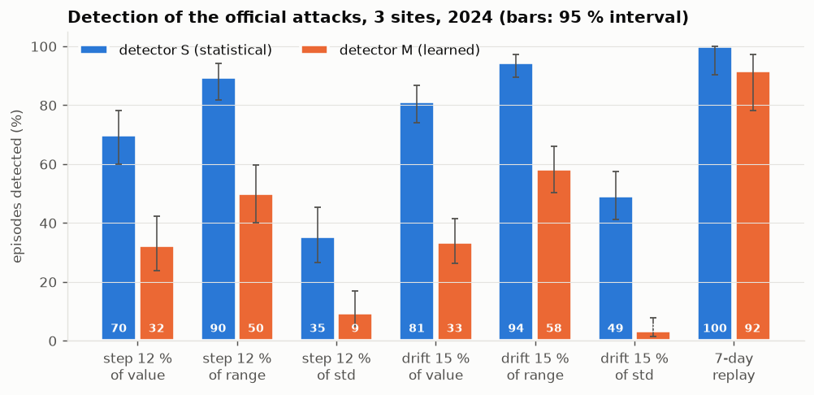

- **Every seven-day replay is caught on its first day** by detector S, with no false alarm.
- Detector S catches 12 % steps and drifts to 15 % in **90–94 %** of cases when the percentage is read as relative to the range, and **70–81 %** relative to the value. Steps are caught in about a week, drifts in about a month.
- **Humidity**, the hardest variable, went from 38–50 % to **71–81 %** caught, thanks to a sharper humidity reference (section 2.5).
- Detector S raises about **4.7 false alarms per station-year**, detector M about 1.7.
- Detector M is now tuned without ever seeing 2024. Its honest numbers are lower than the earlier ones (steps by value 32 %, drifts 33 %), and S is the stronger detector.

### 2.2 What decides detection

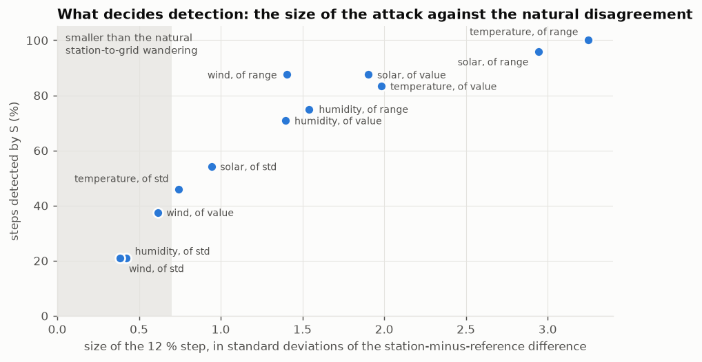

Whether an attack is caught depends almost only on **its size compared with the natural disagreement between the station and the grid**. Sign and season make no difference.
- Above about 1.5 σ (temperature and solar, read as value or range), attacks are almost always caught.
- Below about 0.7 σ (every "12 % of the standard deviation" case, most wind cases), they hide in the natural wandering. This is the physical limit of checking a point sensor against a 50 km reference.

### 2.3 The probability means what it says

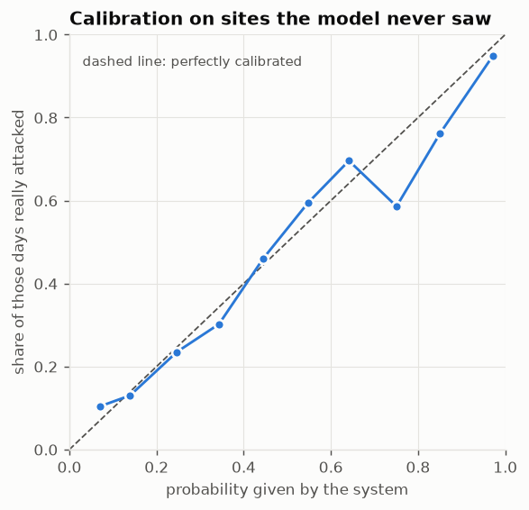

The probability was tested on stations the fusion model never saw (leave one site out). Of the days scored 0.3, 30 % were attacked; of the days scored 0.9–1.0, 95 % were. Per-day ROC-AUC 0.728, Brier score 0.131 against 0.162 for always guessing the base rate.

### 2.4 Decisions with and without the defence

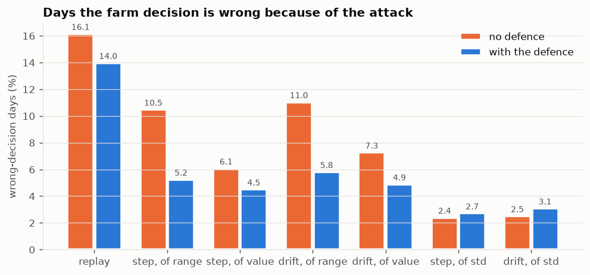

- The defence **cuts the days on which the farm decision is wrong by 32 % overall (7.1 % → 4.9 %), and by up to 50 %**.
- 1 replay out of 36 still produced a wrong decision issued as trusted.
- On clean 2024 data, one of the three honest stations was quarantined once (29 days, Kansas); the defence changed at most 1.1 % of an honest station's decisions. The quarantine threshold rests on few clean days and is the least stable part of the system.
- For the smallest attacks (of the standard deviation) the defence does not help, and it adds slightly to the wrong days. This is reported, not hidden.

### 2.5 What changed in the last round

Three improvements, each tested before it was adopted:

| Change | Why | Effect |
|---|---|---|
| **Humidity reference = a regression** of station humidity on NASA POWER's humidity, temperature, dew point, rain, wind, solar and season, fitted on the training years | POWER's humidity follows a station much less closely than its temperature (correlation 0.76–0.90 against 0.99), so humidity attacks hid in the noise | humidity attacks caught by S: 38–50 % → **71–81 %**, false alarms almost unchanged |
| **Detector M tuned without 2024**: model chosen on attacks injected into 2023, thresholds from leave-one-year-out scores | its thresholds and model had been chosen on the test year, so its numbers were inflated | honest numbers; false alarms on 2024 on target (1.1 %, 1.6 %, 0 % of days) |
| **Month-long gap features** in the fusion (7- and 30-day mean residual, scaled by each station's own training level) | a drift is invisible day by day but clear as a monthly average | per-day ROC-AUC 0.700 → **0.728** (together with the humidity reference) |

Full method and tables: [docs/trust-and-response.md](docs/trust-and-response.md).

---

## 3. The control room (GUI)

```powershell
mingw32-make gui
# or
.\.venv\Scripts\python.exe tools\sensorguard_gui.py
```

One window to run and inspect everything. It has four tabs.

### 3.1 Assess data: run the defence on any file

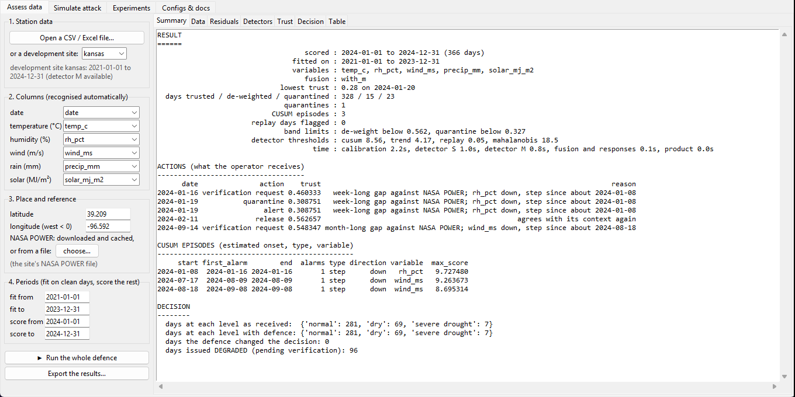

1. **Station data.** Click *Open a CSV / Excel file…*, or pick one of the three development sites from the list.
2. **Columns.** They are recognised automatically: `temp_c`, `T2M`, `Temperature`, `RH2M`, `humidity`, `Rain`, `ALLSKY_SFC_SW_DWN`… Check them in the drop-down lists; set a variable to *(none)* if the file does not have it.
3. **Place and reference.** Give the latitude and longitude (west is negative). NASA POWER for that place and those days is downloaded once and cached. Offline, choose a POWER file instead.
4. **Periods.** The first part of the series is used to learn what is normal at this station (two thirds by default); the rest is scored. Set the dates if you know when the station was clean.
5. Click **Run the whole defence**, then read the pages:

| Page | What it shows |
|---|---|
| **Summary** | the verdict: lowest trust, days in each band, every action with its reason, the CUSUM episodes with estimated onset, the decision with and without the defence |
| **Data** | the station against NASA POWER (raw and calibrated), and the value used downstream after the defence |
| **Residuals** | the standardized disagreement for the chosen variable |
| **Detectors** | each detector's score, its threshold and its alarms |
| **Trust** | the compromise probability and the trust score, coloured by band, with every action marked |
| **Decision** | the water balance and the decision level, with and without the defence |
| **Table** | every daily number, the actions, the episodes, the residuals, the series used |

*Export the results…* writes all of it as CSV files.

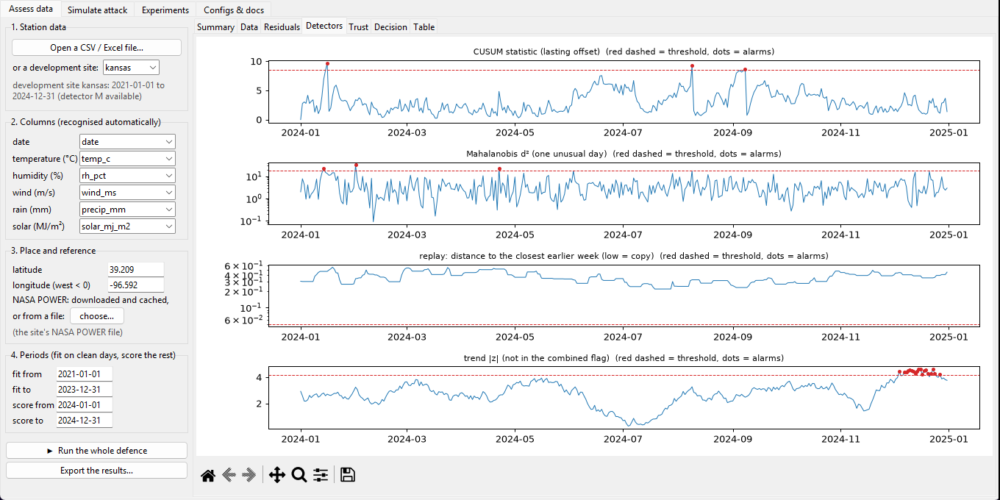

### 3.2 Simulate attack: see the defence react

Choose a development site, an attack (step, drift or replay), its size, what "12 %" is relative to, the onset date, the variables and **the attacker's position** (P1 station, P2 link, P3 pipeline). Click *Inject and run*. Every day goes through layer 1 (signatures, sequence, ledger), then the detectors, and the verdict says how many days layer 1 rejected and after how many days the station was de-weighted and quarantined. The red band on the plots is the true attack.

Below: a 7-day replay at AZMET on 10 July (copied from 28 days earlier). The probability spikes, the station is de-weighted two days later and quarantined two days after that, and it is released once it agrees with NASA POWER again.

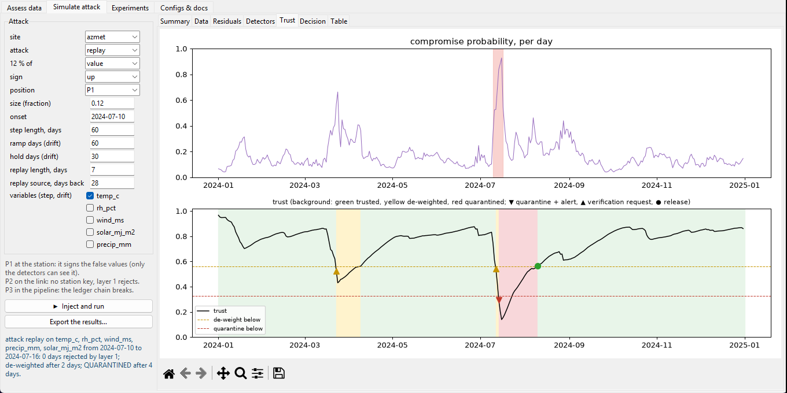

### 3.3 Experiments and Configs & docs

**Experiments** runs the tests and the full evaluations with a live log, and shows their result tables. **Configs & docs** shows every setting (`config/*.yaml`) and every document, and opens them in your editor.

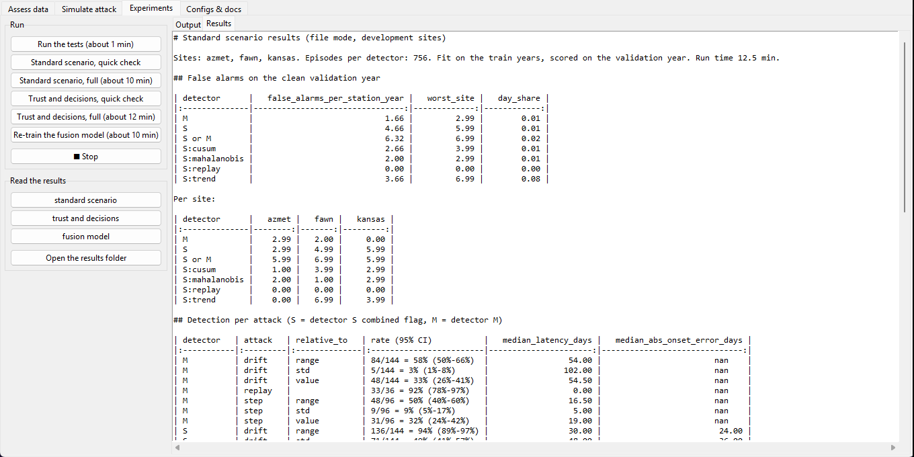

---

## 4. File mode from the command line

```powershell
mingw32-make assess FILE=station.csv LAT=32.48 LON=-109.93
# or, with every option
.\.venv\Scripts\python.exe scripts\assess.py station.csv --lat 32.48 --lon -109.93 `
    --fit-end 2023-12-31 --out results\assess\mine           # fit on everything up to that date, score the rest
    # --power power.csv            use a NASA POWER file instead of downloading
    # --map temp_c=TMP rh_pct=HUM  name a column explicitly
```

**Input.** One row per day (or finer: sub-daily rows are averaged per day, rain summed), a date column, and any of these variables:

```text
date,temp_c,rh_pct,wind_ms,precip_mm,solar_mj_m2
2024-01-01,4.7,38.0,1.3,0.0,13.17
2024-01-02,3.0,43.0,1.6,0.0,11.89
```

| Variable | Unit | Also recognised as |
|---|---|---|
| `temp_c` | °C, daily mean | `T2M`, `temperature`, `tavg`, `tmean` |
| `rh_pct` | %, daily mean | `RH2M`, `humidity`, `rh` |
| `wind_ms` | m/s | `WS2M`, `wind`, `wind_speed` |
| `precip_mm` | mm/day | `PRECTOTCORR`, `rain`, `precipitation`, `prcp` |
| `solar_mj_m2` | MJ/m²/day | `ALLSKY_SFC_SW_DWN`, `solar`, `srad` |

Fill codes such as `-999` become missing. Missing days stay missing; nothing is interpolated. A variable missing from the file is left out of the analysis. The decision product needs all five variables.

**Output** (in `--out`): `summary.csv`, `daily.csv` (detector scores, probability, trust, band, weight, decision and confidence per day), `actions.csv` (date, action, reason), `episodes.csv` (estimated onset, type, variable, direction), `residuals.csv`, `series_used.csv`.

Example, a file the system had never seen (renamed columns, a replay hidden in July):

```text
      date               action  trust  reason
2024-07-11           quarantine  0.519  replay: the week from 2024-07-10 copies an earlier week of the station's own values; ...
2024-07-11                alert  0.519  replay: the week from 2024-07-10 copies an earlier week of the station's own values; ...
2024-08-19              release  0.600  agrees with its context again
```

---

## 5. Install and reproduce

**Install** (Python 3.12, Windows PowerShell, from the repository root):

```powershell
python -m venv .venv
.\.venv\Scripts\python.exe -m pip install -r requirements.txt
.\.venv\Scripts\python.exe -m pip install -e .
```

**Reproduce every number:**

| Command | What it does | Time |
|---|---|---|
| `.\.venv\Scripts\python.exe -m pytest` | 164 tests | about 1 min |
| `python scripts/run_all.py` | standard scenario: 756 attacked runs, detectors S and M → `results/eval/standard/summary.md` | about 10 min |
| `python scripts/run_trust.py` | probability, trust, responses, decisions with and without the defence → `results/eval/trust/summary.md` | about 12 min |
| `python scripts/train_fusion.py` | re-train the frozen fusion model used on new data | about 12 min |
| `python scripts/make_readme_figures.py` | redraw the figures of this README | about 1 min |

`run_all.py` and `run_trust.py` accept `--quick` to check the setup in a minute.

**Rebuild the data** from the providers (the cleaned data is committed in `data/clean_2021_2024/`):

```powershell
.\.venv\Scripts\python.exe data\scripts\fetch_2021_2024.py
.\.venv\Scripts\python.exe data\scripts\clean.py data\raw_2021_2024 data\clean_2021_2024
```

**Makefile shortcuts** (GNU Make is `mingw32-make` on Windows; `mingw32-make help` lists them all):

| Command | |
|---|---|
| `mingw32-make gui` | the control room |
| `mingw32-make assess FILE=… LAT=… LON=…` | file mode |
| `mingw32-make train-fusion` | re-train the fusion model |
| `mingw32-make test` | the tests |
| `mingw32-make l1-gui` | layer-1 panel: send records and watch forged, modified, replayed and dropped ones get caught |
| `mingw32-make install` | create `.venv` and install everything |

---

## 6. Repository layout

```
.
├── config/                 every setting, one YAML file per stage
│   ├── preparation.yaml      calibration against NASA POWER, residuals
│   ├── split.yaml            train 2021-2023, test 2024
│   ├── detector_s.yaml       statistical detector
│   ├── config_m.yaml         learned detector
│   ├── evaluation.yaml       the standard-scenario grid
│   └── trust.yaml            fusion, trust bands, responses, decision product
├── src/sensorguard/        the package
│   ├── data/                 NASA POWER and station clients, cache with checksums
│   ├── attacks/              the three official attacks with exact labels
│   ├── trust/                layer 1: keys, signed records, verification, ledger
│   ├── processing/           calibration, residuals, detector S
│   ├── detect/               detector S runner, detector M, fusion, trust score
│   ├── response/             de-weighting, verification request, quarantine, alert
│   ├── product/              FAO-56 water balance and decision levels
│   ├── eval/                 scenario runners and metrics
│   ├── assess.py             file mode: any series + coordinates -> the whole defence
│   └── pipeline.py           one site end to end, with layer 1 at P1/P2/P3
├── scripts/                assess, run_all, run_trust, train_fusion, make_readme_figures, fetch_data, ...
├── tools/                  sensorguard_gui.py (the control room) and other helpers
├── tests/                  164 tests
├── data/
│   ├── raw_2021_2024/        provider files as downloaded
│   ├── clean_2021_2024/      one schema, full daily calendar (what the pipeline reads)
│   └── scripts/              download, clean, verify
├── results/
│   ├── eval/                 standard scenario and trust results (summary.md in each)
│   └── models*/              calibration, residuals, saved detector M and fusion model
└── docs/                   the documentation (start at docs/README.md); docs/images: the figures above
```

---

## 7. Documentation

| Document | What it covers |
|---|---|
| [docs/README.md](docs/README.md) | index of everything |
| [docs/00-challenge-brief.md](docs/00-challenge-brief.md) · [01-phase1-requirements.md](docs/01-phase1-requirements.md) | the challenge and what Phase 1 requires |
| [docs/02-architecture.md](docs/02-architecture.md) | architecture, trust anchor, record format |
| [docs/03-threat-model.md](docs/03-threat-model.md) | assets, attacker positions, attacks, controls, residual risk |
| [docs/datasets.md](docs/datasets.md) | the stations and NASA POWER: sources, cleaning, checksums |
| [docs/official-attacks.md](docs/official-attacks.md) · [trust-module.md](docs/trust-module.md) | the three attacks; layer 1 |
| [docs/preparation.md](docs/preparation.md) · [detector_s.md](docs/detector_s.md) · [detector_s-fixes.md](docs/detector_s-fixes.md) · [detector_m.md](docs/detector_m.md) | calibration, residuals and the two detectors |
| [docs/evaluation.md](docs/evaluation.md) | **standard-scenario method and results** |
| [docs/trust-and-response.md](docs/trust-and-response.md) | **probability, trust, responses, decisions with and without the defence** |

---

## 8. Limits

- **Small attacks are not caught.** Attacks below about 0.7 σ of the station-to-reference difference (every "12 % of the standard deviation" case, most wind cases) hide in the natural disagreement between a point and a 50 km grid. Closing that gap needs a second independent witness: neighbouring stations, or Sentinel-2.
- **Decisions can still flip early.** Most attacks still produce at least one wrong day before the evidence is strong enough to act. With daily data and a 12 % change, that floor cannot be removed without false alarms on honest stations.
- **File mode needs a clean start.** It learns "normal" from the first part of the series. If the attack started there, it is learned as normal.
- **Detector M is limited.** It exists only for the three development sites, and its replay features look back exactly the offsets used in the replay tests.
- **The quarantine threshold is fragile.** It is the 0.5 % quantile of the clean trust of two stations, so a single clean episode moves it. More clean station-years are needed.
- **Small evaluation base.** Three sites and one test year; no held-out site yet. Sentinel-2 and the evasion experiments are planned, not done.
