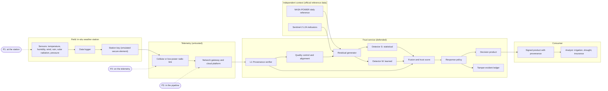
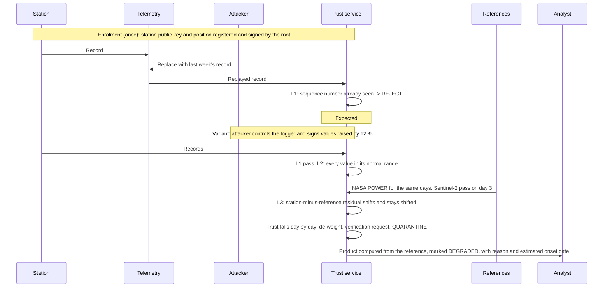
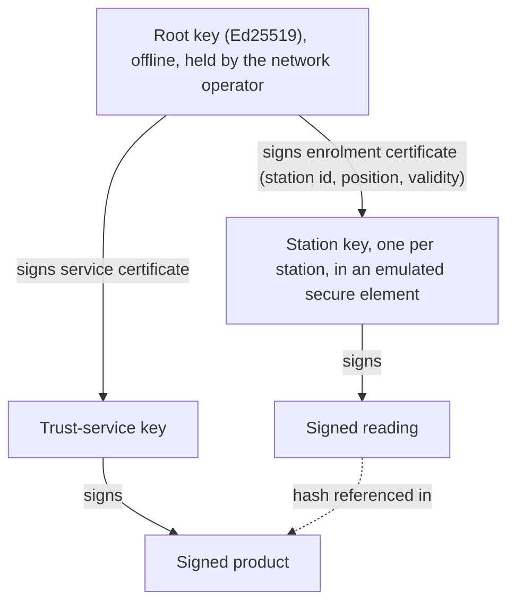

# 02 — Architecture

Track 2 — False Data Injection, in-situ sensing.

## Design principles

1. **Prevent what can be prevented, detect the rest.** Signing each reading at the station stops falsification in transit and in the pipeline. It cannot stop a station that is itself compromised or physically deceived — that station signs false data with a valid key. Detection exists for that case, and it is the case the standard test exercises.
2. **Never trust a sensor alone.** Each reading is checked against the station's own history, the physics linking its variables, the NASA POWER reference for the same place and day, and Sentinel-2 observations of the site.
3. **Real weather is not an anomaly.** Extreme readings are accepted when independent witnesses agree. The detector looks for *disagreement*, not for *extremes*.
4. **Small evidence adds up.** The official attacks are too small to see in one reading. Every check keeps a running account, so a disagreement that persists is caught even when no single day stands out.
5. **Trust is a score, not a switch.** Each station carries a trust score between 0 and 1. It decides how much weight the station's data gets and which response is triggered.
6. **Suspect data never drives a decision alone.** A reading below the trust threshold cannot be the reason a decision changes; the product falls back on the reference and is marked as degraded.
7. **Silence is not normal.** A station that stops reporting is treated as unknown, not as "nothing happened".
8. **Site-agnostic.** The input is a series plus coordinates. Everything site-specific is learned at run time from data available for any point on Earth, because the final test site is hidden.
9. **Everything runs on a laptop.** Python, CPU only, software-emulated trust anchor, no hardware.

## System overview



The same picture in plain text:

```
 sensors ─► logger ─► sign ─► telemetry ─► platform ─► verify ─► QC + align ─► residuals ─► detectors ─► trust score ─► policy ─► product ─► analyst
    ▲                            ▲            ▲                        ▲
 P1: physical or            P2: inject,   P3: modify stored       NASA POWER +
 firmware compromise        replay,       or forwarded data       Sentinel-2 L2A
                            modify, drop
```

## Two ways in

| Mode | Input | Layers that apply | Used for |
|---|---|---|---|
| **Stream mode** | Signed records arriving one per day from an emulated station | L1, L2, L3 | The end-to-end prototype and the with/without comparison |
| **File mode** | A plain daily series plus latitude and longitude | L2, L3 | The standard test and the held-out test, where the jury hands over a series with no signatures |

File mode is one command: series in, per-day trust score, detected episodes (type, estimated onset, end) and recommended actions out. In the standard test the injected values are already inside the series, which is the situation of a compromised station: provenance cannot help, and detection carries the whole result. The report states this plainly.

## One reading, end to end



## Modules

| Module | Responsibility | Input | Output |
|---|---|---|---|
| `data` | NASA POWER client with cache; Sentinel-2 context extractor; station-series loaders; checksums | Coordinates, dates, files | Daily tables per site; reference and context tables |
| `sensor` | Emulate a station: replay authentic readings in date order, sign them | Station record, station key | Signed reading records |
| `trust` | Root and station keys, enrolment, signing, verification, hash chain, replay state, ledger | Reading, keys | Signed record / verdict |
| `transport` | Emulate telemetry at message level: loss, delay, duplication, reordering | Records | Records as received |
| `attacks` | Injection and evasion library, parameterised, at any of the three positions | Clean stream, config | Attacked stream + exact labels |
| `processing` | Quality control, alignment, calibration against the reference, all residuals | Readings, reference, context | Residual vector per reading |
| `detect` | Statistical detector, learned detector, fusion, compromise probability, trust score | Residuals, L1 verdict | Per-reading probability + station trust + reason |
| `response` | De-weighting, verification request, quarantine, alert, substitution | Trust scores | Accepted data set, actions |
| `product` | Turn accepted data into a decision indicator for the site; sign it | Accepted data | Signed product with provenance |
| `eval` | Scenario runner, metrics, resource measurement, figures | Scenario config | Tables and plots |

Each module exposes plain functions over tables and arrays, so any stage can be tested alone and an injection can be inserted at any boundary.

### The decision product

A simple, documented indicator so that the effect of an attack can be measured where it matters: a **30-day water balance** (rainfall minus reference evapotranspiration, computed from temperature, humidity, wind and solar radiation with the standard FAO-56 method) mapped to a small number of levels. An irrigation advisory, a drought class and an index-insurance trigger are all thresholds on indicators of this kind. The contribution is trust in the inputs, not a new agronomic model.

## Trust anchor and provenance

### Key hierarchy



- **Root of trust:** an offline Ed25519 root key held by the network operator. It only signs certificates.
- **Station identity:** each station has its own key pair generated on the device; the private key never leaves it. In the prototype this is a file-backed keystore behind a small `SecureElement` interface exposing only `sign` and `public_key` — the interface a hardware secure element would implement.
- **Enrolment:** the root signs a certificate binding the station's public key to its identifier, **its position** and a validity window. Position matters here more than usual: the reference and the satellite context are looked up by position, so a record that could claim a different place would be checked against the wrong witnesses.
- **Revocation:** a station judged compromised is removed from the registry; its later readings are rejected at L1.
- **Why one key per station:** compromising one station must not let the attacker speak for any other. It also means every false reading is attributable to a specific device.

### Signed reading record

| Field | Size | Purpose |
|---|---|---|
| `version` | 1 B | Format evolution |
| `type` | 1 B | Reading, status, heartbeat |
| `sensor_id` | 4 B | Which station |
| `key_id` | 2 B | Which station key (rotation) |
| `seq` | 4 B | Strictly increasing counter — ordering and replay protection |
| `t_obs` | 8 B | Observation date at the station |
| `prev_hash` | 32 B | SHA-256 of the previous record — hash chain, detects gaps, reordering and history rewriting |
| `payload_len` | 2 B | |
| `payload` | variable | The day's measured values, fixed-point encoded, plus status flags |
| `signature` | 64 B | Ed25519 over every field above |

Fixed overhead is **118 bytes per record**, measured and reported against the payload. At one record per day this is negligible on a cellular link. On low-power long-range radio, where a message can be limited to a few tens of bytes, it is not; a compact mode (truncated chain hash, one signature per batch of days) is described as an option and implemented only if time allows.

### Verification algorithm

```
1. Parse record. Malformed                    -> REJECT (malformed)
2. sensor_id not in registry, or revoked,
   or certificate outside validity             -> REJECT (unknown station)
3. Verify signature with the station's key     -> REJECT (forged or modified)
4. seq <= last accepted seq for this station   -> REJECT (replay)
5. t_obs implausible versus arrival time
   and expected reporting cadence              -> REJECT (stale) or FLAG (delayed)
6. prev_hash != hash of last accepted record   -> ACCEPT, raise GAP (readings missing)
7. Persist seq and hash; pass reading to processing
```

Per-station persistent state is two values: `last_seq` and `last_hash`.

### Cadence watchdog

Stations report once a day. If no valid record arrives within the expected interval plus a margin, the station is marked **silent**. Silence removes the station's weight from the product and lowers confidence; it is never interpreted as an uneventful day.

### Provenance through to the product

The trust service signs each product together with a compact provenance record:

```
product:        indicator, level, site, period
inputs:         list of (sensor_id, seq range, chain hash) used, with the weight given to each
excluded:       list of (sensor_id, reason, estimated onset) quarantined, silent or rejected
references:     NASA POWER request (parameters, point, dates, API version, retrieval time,
                SHA-256 of the response); Sentinel-2 product identifiers, sensing times and
                the hash of the indicators derived from them
processing:     ordered steps (name, version, parameters hash)
confidence:     TRUSTED or DEGRADED, with reason
```

An analyst, or an auditor afterwards, can see exactly which measurements and which reference data justified a decision, which were set aside and why. This is the "origin, time, integrity and processing history" the brief asks for — applied to the reference data as well as to the sensor.

### Tamper-evident ledger

Accepted records, trust scores, actions and issued products are appended to a hash-chained log. Anyone holding a later chain head can prove that earlier entries were not altered or removed. This addresses an attacker inside the pipeline (P3) rewriting stored data after verification.

## Detection layers and fusion

| Layer | Evidence | Catches | Blind to |
|---|---|---|---|
| **L1 Provenance** | Signature, sequence, chain, cadence | Forgery, modification and replay in transit or in the pipeline; suppression | A compromised or physically deceived station — the data is validly signed |
| **L2 Single-sensor analysis** | The station's own history, the season, the physics between its variables, exact repeats of its own past | Freeze, spikes, impossible values, crude replay, one variable changed without the others | A small bias, a slow drift, a careful replay — all look like weather |
| **L3 Context consistency** | NASA POWER reference for the site; Sentinel-2 L2A indicators | A station that drifts away from independent witnesses, however the lie was made | Changes smaller than the reference's own error; variables the reference represents poorly |

### Compromise probability and trust score

- Each detector turns the residuals of a reading into an anomaly score.
- Fusion maps the scores to a **compromise probability** for that reading, calibrated on validation data so that "0.3" means what it says.
- Each station carries a **trust score** between 0 and 1. It falls quickly when probabilities are high and recovers slowly when they return to normal.

| Trust band | State | Response |
|---|---|---|
| High | **Trusted** | Data used at full weight |
| Reduced | **De-weighted** | The station's weight in the fused estimate falls with its trust; a **verification request** is raised |
| Low | **Quarantined** | Data excluded; values substituted from the calibrated reference with wider uncertainty; operator **alert** with the reason and the estimated onset date |
| — | **Silent** | Cadence watchdog expired; excluded; confidence lowered |
| — | **Revoked** | Operator decision; rejected at L1 |

A record that fails L1 is rejected outright and never reaches the score. Band boundaries are chosen on validation data from the trade-off between latency and false alarms, then frozen.

Product confidence is **TRUSTED** when the data behind it comes from trusted stations, otherwise **DEGRADED** with a stated reason. A decision that would change because of a reading from a station that is not trusted is held as pending verification.

Detector details are in [04-signal-processing-and-detection.md](04-signal-processing-and-detection.md).

## Technology choices

| Concern | Choice | Reason |
|---|---|---|
| Language | Python 3.11+ | Team familiarity, reproducibility, scientific stack |
| Time series and numerics | pandas, NumPy, SciPy | Standard |
| Reference data | Plain HTTP client for the NASA POWER API, with an on-disk cache | No account or key needed; small JSON responses |
| Satellite context | A catalogue client and a raster reader to read small windows of Sentinel-2 L2A, or the Copernicus Data Space statistics service | Only a few pixels around the site are needed, never whole tiles |
| Change points | `ruptures` | Listed in the official resources |
| Anomaly detection | PyOD, scikit-learn | Listed in the official resources; CPU-only, small models |
| Crypto | `cryptography` or PyNaCl (Ed25519, SHA-256) | Standard, audited, fast, small signatures |
| Config | YAML scenario files | Every experiment is a file, not a code edit |
| Tests | pytest | |
| Plots | matplotlib | |
| Packaging | pinned `requirements.txt`; optional container file | One-command setup |

Deliberately avoided for Phase 1: deep-learning frameworks, GPUs, real sensor hardware, radio simulation, downloading full satellite tiles. They add risk without adding points.

## Repository layout

```
.
├── README.md                  quick start, one-command reproduction
├── requirements.txt           pinned versions
├── pyproject.toml             makes the package installable
├── docs/                      these documents
├── config/variables.yaml      variable names, units, POWER parameters, physical limits
├── scenarios/                 YAML: sites, standard scenario, injection suite, evasion suite
├── src/sensorguard/
│   ├── schema.py              the four agreed formats, in one place
│   ├── pipeline.py            wires the stages for file mode and stream mode
│   ├── data/                  NASA POWER client, Sentinel-2 context, station loaders, checksums
│   ├── sensor/                station emulation
│   ├── trust/                 keys, enrolment, sign, verify, chain, ledger
│   ├── transport/             telemetry emulation
│   ├── attacks/               injection and evasion library
│   ├── processing/            QC, alignment, calibration, residuals
│   ├── detect/                statistical, learned, fusion, trust score
│   ├── response/              de-weighting, verification, quarantine, alert
│   ├── product/               decision indicator, signed product
│   └── eval/                  runner, metrics, resources, figures
├── scripts/
│   ├── fetch_data             download, cache and verify datasets
│   ├── assess                 file mode: series + coordinates in, trust scores out
│   └── run_all                reproduce every table and figure
├── tests/
├── data/cache/                cached reference responses and derived context tables, with hashes
├── data/raw/                  downloaded station files; not committed
├── keys/                      generated station and root keys; not committed
├── results/                   generated; not committed
└── report/                    report source and figures
```

The file names inside each folder, and the owner of each file, are in [code-architecture.pdf](code-architecture.pdf).

`sensorguard` is a neutral placeholder name; rename freely as long as it identifies no one.

## Declared simplifications

Stated openly in the report so the jury sees them as choices, not gaps.

- Stations are emulated by replaying authentic historical records in date order. No physical sensor is used.
- Telemetry is modelled at message level (loss, delay, duplication, reordering), not at radio level.
- The secure element is emulated in software behind a hardware-shaped interface.
- Attacks are injected into authentic clean records. This gives exact labels; it also means our attacker is only as clever as our injection library, which is why evasion, held-out sites and a held-out injection type are tested.
- Cadence is daily, because the official reference is daily. Detection latency is therefore counted in days.
- The decision product is a simple, documented indicator. The contribution is trust in the inputs.
- Reference data needs a network connection the first time; afterwards everything runs from the local cache.
- Confidentiality is out of scope: weather observations are public.
