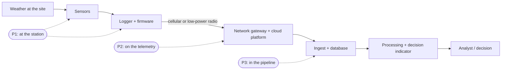

# 03 — Threat model

Track 2 — False Data Injection, in-situ sensing.

## Guiding question

> Is this sensor stream consistent with its context?

That is the track's own question. The stream is an **in-situ measurement**: the ground truth itself. The context is everything independent of the sensor that describes the same place and time.

## Segment under analysis

A network of weather stations on agricultural land, reporting daily values to a service that turns them into irrigation advice, drought indicators and index-insurance triggers.

**Trust boundaries**

| Zone | Trust | Why |
|---|---|---|
| The physical environment | Ground truth | What we are trying to know |
| Sensors and logger | **Conditionally trusted** | Unattended in a field for months, reachable by anyone who walks up to it, firmware rarely updated |
| Telemetry link, gateway, cloud platform | Untrusted | Third-party infrastructure; small messages, often unauthenticated end to end |
| Ingest, database, intermediate processing | Untrusted | Reachable from the internet; data is rewritten and reformatted in several hands |
| Detection and decision module | Trusted | The component we build and must trust |
| Independent context (NASA POWER, Sentinel-2) | Trusted **as witnesses**, with known error | A ground attacker cannot change what a satellite saw or what a global reanalysis computed |

## Why in-situ sensors are exposed

- **Unattended and reachable.** A station stands alone in a field. No boat, no climbing gear: a person and a few minutes are enough.
- **The person with access may be the person who benefits.** An index-insurance policy pays when the station records too little rain or too much heat. A water allocation follows recorded demand. The holder of the land often hosts the station.
- **Constrained and cheap.** Low-cost hardware, little power, small messages: security features are the first thing left out.
- **Sparse.** Few stations cover a large area, so each one carries a lot of weight. Falsifying one can move a decision.
- **Trusted by default.** In-situ data is what satellite products are validated against. It is rarely itself questioned.
- **Faults look the same.** Humidity sensors drift, radiation sensors get dirty, rain gauges clog, shields degrade. An operator's first explanation for odd data is "the sensor is acting up", not "we are under attack". A slow drift is both the most common fault and one of the official attacks.

## Assets and required properties

| Asset | Property | Failure means |
|---|---|---|
| A measurement | Integrity, **truthfulness** | The indicator and the decision built on it are wrong |
| Measurement origin and position | Authenticity / provenance | A reading claims to be from a station or a place it did not come from |
| Measurement time and order | Freshness | Last week's weather presented as this week's |
| Measurement stream | Availability, **detectable absence** | An event goes unrecorded and nobody notices |
| Reference and context data | Integrity, traceable origin | The witnesses themselves cannot be audited |
| Processing history | Auditability | Cannot trace a decision back to the readings behind it |
| Station private keys | Confidentiality | Attacker signs as the station |
| Station registry, replay state, ledger | Integrity | Verification can be subverted |
| Calibration, baselines and models | Integrity | Attacker teaches the detector that false is normal |

Note the distinction in the first row. **Integrity** means the reading was not changed after the station produced it; cryptography delivers that. **Truthfulness** means the reading reflects the weather; only cross-checking delivers that. Track 2 lives in the gap between the two.

## Attacker profiles

| ID | Position | Capability | What signatures do | Cost |
|---|---|---|---|---|
| **P1a** | At the sensor | Deceives the physical measurement: shades the radiation sensor, covers or waters the rain gauge, warms or cools a probe, relocates the station | **Nothing** — the station honestly signs what it measured | Very low: hands and household objects |
| **P1b** | In the logger or firmware | Changes values before they are signed — a calibration factor is enough for a 12 % bias; may extract the station key | **Nothing** — false data carries a valid signature | Medium: physical access or a firmware vulnerability |
| **P2** | On the telemetry link, gateway or platform | Reads, injects, modifies, replays, delays and drops messages | **Stops** forgery, modification and replay; does not stop dropping | Low to medium |
| **P3** | In ingest, database or intermediate processing | Rewrites stored or forwarded values; deletes records | **Stops** it, if verification happens end to end and the ledger is checked | Medium: requires an intrusion or an insider |

**Attacker knowledge levels** used in evaluation:

- **Black box:** knows what the station measures, not the defence.
- **Grey box:** knows the defence design and which checks exist, not thresholds or trained models.
- **White box:** knows thresholds and models, and reads the same public NASA POWER and Sentinel-2 data we use.

**Assumed out of reach:** the offline root key; breaking Ed25519 or SHA-256; falsifying NASA POWER or Sentinel-2 at their source.

## Injection attacks

The first three are the official standard test.

| ID | Attack | Typical position | What happens | Impact |
|---|---|---|---|---|
| **F1** | **Step bias** (standard: 12 %) | P1, P2, P3 | From one day onward every value is raised or lowered by a fixed proportion | An indicator crosses, or fails to cross, a threshold |
| **F2** | **Gradual drift** (standard: up to 15 %) | P1, P2, P3 | The offset grows slowly to its final size | As F1, but built to stay under change detectors and to pass for sensor ageing |
| **F3** | **Replay** (standard: seven samples) | P1b, P2, P3 | A recorded stretch of genuine past data is played back in place of the current days | A rain event, a frost or a hot spell is hidden behind perfectly realistic data |
| **F4** | **Freeze** | P1, P2 | The last value is repeated | The station appears alive while reporting nothing new |
| **F5** | **Event masking or fabrication** | P1b, P2, P3 | A specific event is erased or invented: a rainy week removed, a dry spell or a heatwave inserted | A payout is triggered or avoided; advice is wrong when it matters |
| **F6** | **Noise or spike injection** | P1, P2 | Random noise or outliers added | Degrades quality control; hides other manipulation; provokes false alarms |
| **F7** | **Suppression** | P1, P2, P3 | Readings are dropped | A gap exactly when the data matters |
| **F8** | **Delay / date shift** | P2, P3 | Readings arrive late or carry altered dates | The picture lags reality |
| **F9** | **Coordinated injection** | Several variables or several stations | Consistent false values across variables, or at neighbouring stations | Defeats the checks between variables and between stations |
| **F10** | **Provenance stripping** | P2, P3 | Signature fields removed so the record looks like a legacy unsigned one | Verification silently skipped |
| **F11** | **Station key compromise** | P1b | Attacker signs arbitrary readings as the station | Forgeries pass L1 |

A worked case: an index-insurance contract pays when the 30-day rainfall total falls below a trigger. Lowering the recorded rainfall by 12 %, or replaying a dry week over a wet one, moves the total across the trigger. The analyst never sees a forged document; they see a genuine, correctly signed series that happens to be false. That is the silent failure the challenge brief describes.

### STRIDE view

| STRIDE | Attacks |
|---|---|
| Spoofing | F5, F11 |
| Tampering | F1, F2, F3, F4, F5, F6, F9, F10 |
| Repudiation | A station's data cannot be attributed, or an operator cannot show what a decision was based on — addressed by per-station signatures and the ledger |
| Information disclosure | Out of scope |
| Denial of service | F7, F8 |
| Elevation of privilege | F11 |

## Evasion strategies

An informed attacker adapts to the defence. Each of these is an experiment in the evaluation.

| ID | Target | Strategy |
|---|---|---|
| **E1** | Change detection | **Slower, smaller drift:** stretch the ramp over months, or stop below the level any detector can accumulate |
| **E2** | Quality control | **Stay in bounds:** keep every value inside range, rate-of-change and seasonal limits |
| **E3** | Physical consistency | **Consistent multi-variable lie:** change temperature, humidity and radiation together so the relationships between them still hold |
| **E4** | Reference comparison | **Analogue replay:** read NASA POWER, find the past week whose weather best matches the current one, and replay that week |
| **E5** | Replay detection | **Perturbed replay:** add small noise to replayed data so it is not an exact duplicate |
| **E6** | Reference and satellite context | **Hide in the reference's error:** attack the variables and seasons where a grid cell represents a point badly (rain, wind), keep the offset inside the normal station-to-reference spread, act during cloudy periods when Sentinel-2 sees nothing |
| **E7** | Calibration and learned model | **Baseline poisoning:** be present while the system is learning what normal looks like |
| **E8** | Operators | **Fault mimicry and alarm fatigue:** shape the manipulation like ordinary sensor ageing, or provoke so many alarms that they are ignored |
| **E9** | Everything | **White-box optimisation:** search for the largest decision-relevant change that keeps every score under its threshold |

E9 gives the most useful number in the whole evaluation: **how large a bias can a fully informed attacker sustain without being caught?** If the answer is below 12 %, the official attack is inside our reach; and compared with the spacing between decision levels it says whether the defence works in the sense that matters.

## Controls

| Attack | L1 provenance | L2 single-sensor analysis | L3 context consistency | Outcome |
|---|---|---|---|---|
| F1 step bias | Prevents at P2, P3 | Weak: 12 % sits inside day-to-day weather; catches physical ceilings being exceeded | **Detects** a persistent shift against the reference | Prevented in transit; detected at the station after some days |
| F2 gradual drift | Prevents at P2, P3 | Blind by design of the attack | **Detects** once the accumulated offset exceeds the reference's error | Detected late; bounded |
| F3 replay | **Prevents** at P2, P3 (sequence, chain) | Detects exact or near repeats of the station's own past | **Detects** — replayed days stop following the reference's day-to-day weather | Prevented in transit; detected at the station |
| F4 freeze | — | **Detects** zero variance | Detects | Detected |
| F5 masking / fabrication | Prevents at P2, P3 | Detects unphysical onset | **Detects** | Prevented / detected |
| F6 noise, spikes | Prevents at P2, P3 | **Detects** | — | Detected |
| F7 suppression | **Detects** (cadence, chain gap) | — | Substitutes from the reference | Detected, not prevented |
| F8 delay | **Detects** (date versus arrival, sequence) | — | Detects lag against the reference | Detected |
| F9 coordinated | Prevents at P2, P3 | Checks between variables defeated | Reference and satellite context still hold | Partially mitigated |
| F10 stripping | **Prevents** (unsigned is never accepted in stream mode) | — | — | Prevented |
| F11 key compromise | Defeated; limited by revocation | Applies unchanged | **Applies unchanged** | Detected by content |

What each layer adds beyond the others:

- **Signatures alone** close the telemetry and the pipeline completely, and do nothing at the station.
- **Single-sensor analysis alone** catches clumsy manipulation and ordinary faults, and is blind to the three official attacks when they are done with any care.
- **Context consistency alone** catches a lying station regardless of how the lie was made, but is only as sharp as the reference is accurate for that variable and that place.

The layers fail in different places, which is the argument for having all three.

## Residual risk — stated honestly

- **A bias smaller than the reference's own error is undetectable.** The defence bounds how far an attacker can move the picture; it does not make the bound zero. The evaluation measures the bound per variable.
- **Some variables are weakly protected.** Daily rain and wind at a point are poorly represented by a grid cell tens of kilometres wide. A 12 % bias on them may only show in monthly totals, if at all.
- **Sentinel-2 is a sparse, slow witness.** One clear view every few days at best, none under cloud, and it sees the consequences of weather rather than weather itself.
- **The reference is not perfectly independent.** A reanalysis may have used observations from public stations. This is checked and stated per variable.
- **Attacks and faults look alike.** The system detects that a stream is wrong, not why. Attribution is left to the operator; the response is the same either way.
- **Availability cannot be guaranteed.** Suppression is detected and compensated, not prevented.
- **A compromised trust service** signs false products regardless of the inputs. Out of scope here; the provenance record at least makes it auditable.

## Out of scope

Attacks on satellites, on NASA POWER or on the Copernicus services themselves; confidentiality; denial of service against the trust service; the correctness of the agronomic or insurance model downstream.

## Evidence the threat is real

Candidate references for the report. **Verify every title, author list, venue and year against the original before citing.**

- Liu, Ning and Reiter, "False Data Injection Attacks against State Estimation in Electric Power Grids", ACM CCS, 2009 — the foundational result that coordinated false data can pass residual-based checks. Supports F9 and E9.
- The Stuxnet case — recorded normal sensor readings were replayed to operators while the physical process was being driven out of bounds. Supports F3.
- Published work on sensor-level physical signal injection (acoustic attacks on accelerometers, electromagnetic injection into analogue sensor lines). Supports P1a.
- The literature on weather-index insurance, which discusses tampering with ground stations and moral hazard as a reason to prefer or add satellite-based indices. Supports the insider motive.
- World Meteorological Organization guidance on quality control of automatic weather station data — evidence that implausible data is a recognised operational problem and a source of accepted test definitions for L2.
- FAO Irrigation and Drainage Paper 56 — the reference-evapotranspiration method behind the decision indicator, and its guidance on checking the integrity of weather data.
