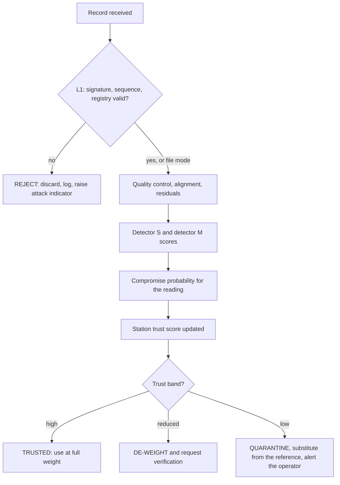

# 04 — Signal processing and detection

Track 2 — False Data Injection, in-situ sensing. Covers two rubric lines: **signal processing (15 pts)** and **detector design & evaluation (20 pts)**.

## Core idea

A true measurement has to agree with four things at once: **the season and the station's own recent past, what its other variables say, what the reference says for the same place and day, and what the satellite sees.** An attacker who changes the numbers breaks at least one of those agreements. Signal processing turns each agreement into a **residual** — the difference between what was reported and what was expected. On clean data residuals are small noise, heatwave or no heatwave. Under injection, at least one of them moves and stays moved. The detectors watch residuals, never raw values.

Two things follow:

- The system accepts 42 °C during a real heatwave, because the reference says 41 °C too.
- The system catches a 12 % bias that no single day reveals, because the residual it creates never averages back to zero.

## Pipeline

```
readings -> quality control -> calendar alignment and gap handling -> calibration against the reference
         -> residuals: temporal | physical | reference | orbital context | replay
         -> detector S (statistical) + detector M (learned) -> fusion
         -> compromise probability -> station trust score -> response
```

## Variables

Daily values. The working set is what NASA POWER provides and a weather station measures:

| Variable | NASA POWER parameter | Note |
|---|---|---|
| Air temperature at 2 m: mean, maximum, minimum | `T2M`, `T2M_MAX`, `T2M_MIN` | |
| Dew point or relative humidity | `T2MDEW`, `RH2M` | |
| Wind speed | `WS2M` | |
| Surface pressure | `PS` | |
| Precipitation | `PRECTOTCORR` | Intermittent; treated separately |
| Solar irradiance at the surface, all-sky and clear-sky | `ALLSKY_SFC_SW_DWN`, `CLRSKY_SFC_SW_DWN` | |

Confirm the exact parameter names, units and the fill value for missing data against the API's own parameter list when writing the client. The code treats variables generically through a configuration file.

### How hard is a 12 % step, per variable?

Rough expectations, written down so that the design is aimed at the right problem. **Replace every line with a measured number in week 2.**

| Variable | A 12 % step is roughly | Expected difficulty | Why |
|---|---|---|---|
| Surface pressure | Over 10 kPa | Trivial | Weather moves pressure by a few per cent at most |
| Solar irradiance | 2–3 MJ/m² on a clear summer day | Easy on clear days, moderate otherwise | Clear days have a physical ceiling |
| Air temperature in °C | 2–4 °C in a warm season, almost nothing near 0 °C | Moderate and season-dependent | About the size of the station-to-grid difference; depends on the unit |
| Relative humidity | 5–10 points | Moderate | |
| Wind speed | A few tenths of a metre per second | Hard | Wind at a point is poorly represented by a grid cell |
| Precipitation | 12 % of rainy-day totals | Very hard day by day | Most days are zero; only accumulated totals carry the signal |

## Stage 1 — Quality control

Standard tests from established practice for automatic weather stations. They remove ordinary faults and catch crude injections cheaply.

| Test | Flags |
|---|---|
| Gross range | Value outside sensor or physical limits |
| Seasonal range | Value outside what this location sees at this time of year |
| Spike | A single day far from its neighbours in time |
| Rate of change | Change between consecutive days larger than plausible |
| Flat line | The same value repeated too many times |
| Internal order | Minimum above mean, mean above maximum, dew point above temperature |
| Timing | Missing, duplicated or out-of-order dates |

Quality-control flags are both a filter and a set of detector inputs. They are deliberately the **weakest** layer: a competent attacker stays inside all of them (evasion E2), and the report says so.

## Stage 2 — Alignment and gaps

- **Day boundaries.** A station may define its day by local midnight, by UTC, or by a morning observation hour; the reference has its own convention. For each variable, the lag of −1, 0 or +1 day that best aligns station and reference is found once on clean data and fixed.
- **Gaps.** Missing days are marked, not filled. A residual that depends on a missing value is itself marked missing. Nothing is silently interpolated, because an interpolated value looks exactly like a smooth injection.

## Stage 3 — Calibration against the reference

This stage is the answer to "accounting for spatial/temporal mismatch and natural variability".

A station measures a point. NASA POWER describes a grid cell tens of kilometres wide, at the cell's average elevation. The two differ systematically (the station is higher, more sheltered, nearer the coast) and randomly (a shower hits one and misses the other). Neither difference is an attack.

- **Systematic part.** A robust linear map from reference to station, fitted per variable and per season. Robust fitting (medians and rank-based slopes rather than least squares) is used so that an injection hidden inside the fitting period cannot bend the map much.
- **Random part.** The spread of what remains, per variable and per season. This is the yardstick every residual is measured against.
- **Rain.** Compared as 7-day and 30-day totals and as wet-day agreement, not as daily amounts.
- **Natural variability.** Disappears in the subtraction: a heatwave raises the station and the reference together.

Two operating modes, because the final site is hidden:

| Mode | When | How |
|---|---|---|
| **Calibrated** | A clean history of the station is available | Fit the map on that history, freeze it, version it by hash |
| **Cold start** | Only the series under test is given | Fit the map robustly on the whole series; rely on change-point detection, which needs no clean baseline — it looks for a moment where the station-to-reference relationship *changes* |

## Stage 4 — Residuals

### R1 — Temporal residual

The expected value for the day from the season and the station's own recent past: a seasonal baseline (available for any point from the reference's long history) plus a simple autoregressive model on the departures from it. The residual is reported minus predicted, in units of the predicted spread.

- Catches: freezes (F4), spikes (F6), abrupt fabricated events (F5).
- Does not catch: a 12 % step or a slow drift — both are smaller than ordinary day-to-day weather. Stated openly; this is why context is needed.

### R2 — Physical-consistency residuals

Relationships between variables at the same station.

| Relationship | Residual |
|---|---|
| Solar ceiling | Measured irradiance divided by the irradiance at the top of the atmosphere for that latitude and day cannot exceed a known limit. A raised irradiance breaks the ceiling on clear days |
| Temperature range and sunshine | The gap between daily maximum and minimum grows with sunshine; a scaled maximum or a scaled irradiance falls off the relation |
| Temperature, dew point and humidity | Linked by a fixed formula when two of the three are reported |
| Rain and sky | Rainy days come with low sunshine and high humidity |
| Pressure and elevation | Station pressure stays in a narrow band set by its altitude |
| Ordering | Minimum ≤ mean ≤ maximum |

- Catches: manipulation of one variable without the others; a multiplicative bias on any variable with a physical ceiling.
- Does not catch: a manipulation that changes all variables consistently (E3).

### R3 — Reference residual (NASA POWER)

The main witness. Station value minus calibrated reference value, in units of the calibrated spread. Two forms are computed, because the unknown "12 %" may be multiplicative:

| Form | Definition | Why |
|---|---|---|
| Difference | station − calibrated reference | Natural for temperature |
| Log-ratio | log(station / calibrated reference) | For positive variables a proportional bias becomes a constant shift, whatever the season |

Both the grid cell containing the site and its neighbours are used, so the residual does not hang on a single cell.

- Catches: a persistent shift (F1), a growing shift (F2), days that stop following the reference's weather (F3), however the manipulation was produced.
- Does not catch: an offset smaller than the calibrated spread can resolve in the time available; variables the reference represents poorly.

Two points to state openly in the report. First, a reanalysis may have used observations from public stations, so it is not perfectly independent — check per variable and say what was found. Second, if the organizers' standard test injects into a NASA POWER series itself, comparing it with the same NASA POWER cell would be trivial and meaningless; in that case the residual is built from neighbouring cells, other variables and the satellite context only.

### R4 — Orbital-context residual (Sentinel-2 L2A)

For each Sentinel-2 acquisition over the site, a small window around the station is read and reduced to a few numbers:

| Indicator | From | Relates to |
|---|---|---|
| Cloud and cloud-shadow fraction | Scene classification layer | Sunshine and rain on that day |
| Snow fraction | Scene classification layer | Temperature |
| Vegetation index (NDVI) | Red and near-infrared bands | Accumulated water and heat over weeks |
| Moisture index (NDMI) | Near- and short-wave infrared bands | Recent rain and evaporation |
| Water index (NDWI) | Green and near-infrared bands | Standing water after heavy rain |

Residuals built from them:

- **Sky agreement:** the station's sunshine (irradiance relative to the clear-sky value) against the cloud fraction seen from orbit on the same day.
- **Water-balance agreement:** the change in moisture and vegetation indices over a few weeks against the water balance computed from the station. The same is computed from the reference, which makes Sentinel-2 an **arbiter**: when station and reference disagree, which of the two better explains what the satellite saw?
- **Snow agreement:** snow on the ground against reported temperature.

Honest limits, to be written in the report: at best one clear view every few days, none under cloud; a snapshot at mid-morning against a daily mean; and vegetation responds to weather over weeks, not days. Its statistical power against a 12 % step is low. Its value is that it is the one witness no ground attacker and no data-pipeline intruder can influence, and that it helps most with long drifts and with replays that contradict the sky. The ablation measures exactly what it adds.

Only derived indicators are stored, with the product identifiers they came from. Whole tiles are never downloaded.

### R5 — Replay residuals

| Feature | Catches |
|---|---|
| Smallest distance between the last 5–10 days and any earlier stretch of the station's own record, across all variables at once | Replay (F3): nature does not repeat a week to the decimal. Stretches with no information (a week of zero rain) are ignored |
| Correlation between the station's and the reference's day-to-day changes over a sliding week | Replay, even perturbed (E5): replayed days follow last month's weather, not this week's |
| Paired jumps a fixed number of days apart | The two splice points where the replayed block begins and ends |

## Residual validation gate

Before any attack is run, each residual is plotted on clean data and must be:

- centred near zero, with stable spread;
- **no larger during genuine extreme weather than on ordinary days**, after normalisation;
- **similar from one climate to another**, because the final site is unknown.

If a residual blows up in real heatwaves or on one kind of site, it will generate false alarms exactly when the system is needed, and it is fixed or dropped. These plots go in the report.

## Detectors

Two detectors on the same residual vector, so the report compares interpretable statistics with a learned model.

### Detector S — statistical

| Component | Target | Method |
|---|---|---|
| Single-day test | Large, abrupt manipulation | Distance of the day's residual vector from its clean-data distribution (Mahalanobis, robust covariance) |
| **Running-sum test (CUSUM)** | **Step bias** | Two-sided cumulative sum on each reference residual. Small daily disagreements add up; honest noise cancels |
| **Change-point search** | **Step bias and drift**, with an onset date | `ruptures` on a sliding window of the reference residual: a mean-shift cost for steps, a piecewise-linear cost for drifts |
| **Trend test** | **Gradual drift** | Robust slope of the residual over the last 30, 60 and 90 days, and the long-window mean of the log-ratio against its calibrated baseline |
| **Replay matcher** | **Replay** | The three R5 features |

A reading is flagged if any component fires; the firing component names the reason and, for steps and drifts, estimates when it began.

Strengths: no training on attacks, fully explainable ("station has read 11 % above the reference since 3 June"), negligible memory and time. This is the detector that must work.

### Detector M — learned one-class model

Candidates from PyOD, benchmarked against each other: Isolation Forest, ECOD, COPOD, HBOS and a nearest-neighbour method. Input: features of a sliding window of residuals (mean, slope, spread, running sums, week-scale correlation with the reference, replay distance, quality-control flags). Trained on **clean windows only**, pooled over several sites — the features are normalised residuals, so they mean the same thing everywhere.

Why one-class rather than a supervised classifier:

- Phase 2 scores a **held-out** attack. A classifier trained on our own injections learns our injection library, not attackers in general.
- Real networks have years of clean data and almost no labelled attacks.

A supervised model (random forest) is trained once as an **upper-bound reference only**, and tested on an injection type excluded from its training, to show the generalisation gap explicitly.

### Protecting the baselines

To resist slow drifts (E1) and poisoning (E7):

- calibration, baselines and models are fitted offline on a fixed clean period and versioned by hash;
- any online adaptation is frozen while a detector is firing and bounded relative to the fixed reference;
- the running-sum test on the reference residual has no adaptation at all — a slow drift can outwait a model that follows the station, but it cannot outwait a comparison with an independent source.

## Fusion, compromise probability and trust score



- **Compromise probability.** The detectors' scores are fused and mapped to a probability. The mapping is fitted on validation data and its calibration is shown with a reliability diagram: of the readings scored near 0.3, about 30 % should be compromised.
- **Trust score.** A number between 0 and 1 per station, updated each day from the compromise probability. It falls fast and recovers slowly, so one quiet day does not restore a station that has just been caught.
- **Reason.** Every change of band carries the component that fired, the variable, the size of the disagreement and the estimated onset date. Rule-based reasons are kept on purpose: an operator and a jury can read them.

Disagreement is resolved by weight of independent evidence: a station against the reference *and* the satellite context is suspect; a station that agrees with the satellite against the reference suggests the reference is wrong for that place, and the station keeps its trust.

## Response

The four responses the track names, graded by trust.

| Situation | Action |
|---|---|
| Trust reduced | **De-weighting:** the fused estimate leans toward the calibrated reference in proportion to the lost trust |
| Trust reduced and still falling | **Verification request:** ask for independent evidence — the next clear Sentinel-2 view, a neighbouring station, a technician's visit — and log what was asked |
| Trust low | **Quarantine:** station excluded; values replaced by the calibrated reference with its wider uncertainty |
| Quarantine entered, or a record rejected at L1 | **Alert:** operator notified with the reason and the estimated onset date |
| Station silent | Excluded; treated as unknown |
| A decision would change because of a non-trusted station | Held as pending verification; product confidence set to DEGRADED |
| Station agrees with its context again for a sustained period | Trust recovers; released from quarantine |

## Cost

Targets to be **measured, not assumed**:

- the running sums and the trust score hold a handful of numbers per variable per station;
- calibration is a small table per site;
- change-point search runs on a window of a few hundred days;
- detector M is a small model;
- one Ed25519 verification per record;
- a year of reference data for one site is a few tens of kilobytes; Sentinel-2 context is a small table per site.

Measured time per reading, peak memory and model size are reported for each component in [05-evaluation-plan.md](05-evaluation-plan.md).
