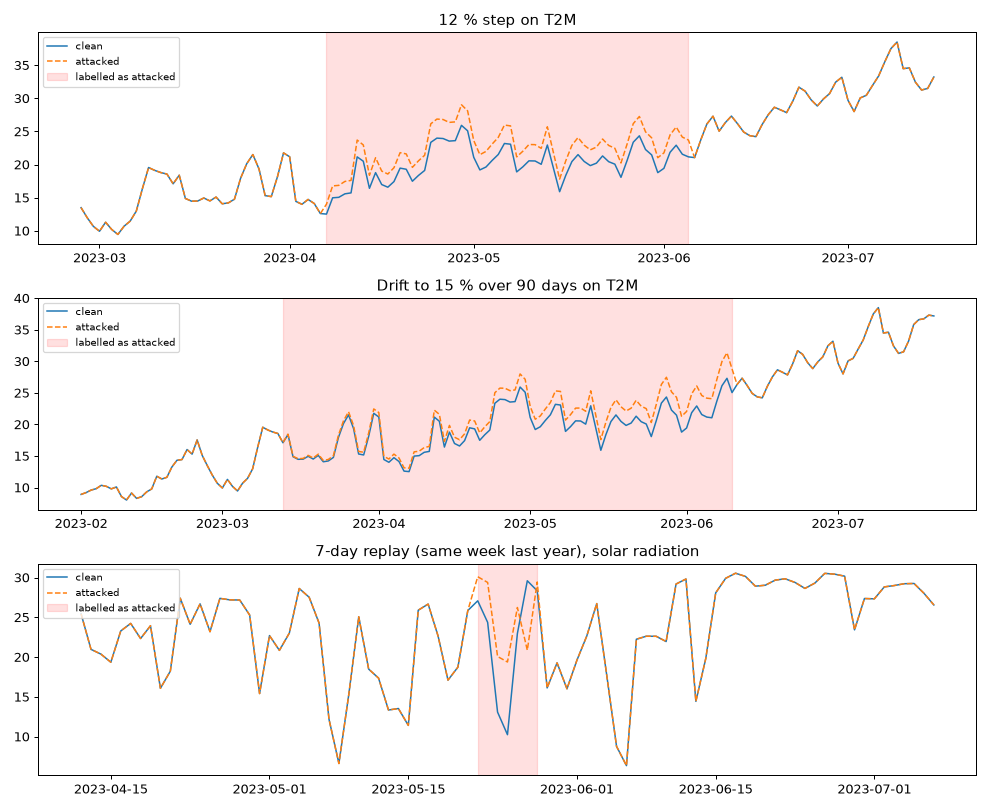

# The three official attacks: how they are built

> Branch: `feat/official-attacks` · commit `e26857c` · date: Sunday 18 October 2026

---

## 1. In 30 seconds

I am **Member 3: trust, attacks and threat model**.

The first thing I delivered is **the three attacks of the official standard test**:

| Attack | What it does | Official size |
|---|---|---|
| **Step bias** | From one day on, every value is pushed up (or down) by the same percentage | 12 % |
| **Drift** | The error starts at almost 0 and grows a little every day | up to 15 % |
| **Replay** | 7 real days are replaced by 7 *older* real days | 7 samples |

For each attack the code gives three things:

1. the **attacked series** (the fake data),
2. **per-day labels** saying exactly which days were attacked and by how much,
3. an **episode table** with one line per attack (start, end, parameters).

Why the labels matter: Member 4 must measure "did the detector catch the attack, and how many days late?". Without exact labels, that cannot be measured.

Why I started with this rather than the signatures: it was due Wed 14 and **Members 2 and 4 cannot test anything without attacked data**. The signatures (trust module) come next.



*Top: 12 % step on temperature. Middle: drift to 15 % over 90 days. Bottom: a replay hides a real cloudy week (the dip in blue) behind sunny days copied from last year: the orange line looks completely normal.*

---

## 2. What I did, step by step

| Step | What | Where |
|---|---|---|
| 0 | New git branch so I don't touch the shared skeleton | `feat/official-attacks` |
| 0 | A Python environment with the libraries (numpy, pandas, pyyaml, pytest, cryptography, matplotlib) | `.venv/` (ignored by git) |
| 1 | Chose the **format** of the data and the labels (the team never agreed on it) | `src/sensorguard/attacks/labels.py` |
| 2 | The three attacks + a function that places them at random but reproducibly | `src/sensorguard/attacks/official.py` |
| 3 | One settings file per attack | `scenarios/standard/*.yaml` |
| 4 | 27 automatic tests | `tests/test_attacks.py` |
| 5 | Downloaded real NASA POWER data for 3 sites to test on real weather | `data/raw/*.csv` (not committed, see section 6) |
| 6 | Ran every scenario on the 3 sites **twice** → 3,087 files, all identical | `results/attacks/` (not committed) |
| 7 | Plotted the result to check by eye | `tools/attacks.png` |

---

## 3. Each file in detail

### 3.1 `src/sensorguard/attacks/labels.py` — the labels

**The input format the attacks expect** (the "reading table"):

- a pandas table, **one row per day**, dates as the index;
- **no skipped days**: a missing day must be a row of empty values (NaN), not a missing row;
- one column per variable, with NASA POWER names (`T2M`, `RH2M`, ...).

Why "no skipped days"? The attacks count in rows. If a day is missing, "replay 7 days" would silently become "replay 7 rows" covering 8 real days. The function `check_daily()` refuses such data with an error instead of giving wrong labels.

**The per-day labels** (one row per day, same dates as the data):

| Column | Meaning | Example |
|---|---|---|
| `attacked` | True on every day inside an attack | `True` |
| `attack` | which attack | `none`, `step`, `drift`, `replay` |
| `episode_id` | which attack episode (−1 = clean day) | `0` |
| `variables` | attacked variables, joined by `;` | `T2M` |
| `fraction` | size of the change that day | `0.12` for +12 %, `0.075` halfway through a drift |
| `source_date` | replay only: the day that was copied here | `2021-07-02` |
| `clipped` | True if the fake value had to be cut to a physical limit | humidity cannot go above 100 % |

**The episode table**: one row per attack: `episode_id, attack, variables, onset, end, magnitude, sign, relative_to, seed, params`. `onset` = first attacked day, `end` = last attacked day (included).

**The functions:**

| Function | What it does |
|---|---|
| `check_daily(index)` | Refuses data that is not one row per consecutive day |
| `empty_labels(index)` | Labels where every day is clean |
| `mark(labels, days, episode, ...)` | Returns a **copy** of the labels with these days marked as attacked. Refuses two attacks on the same day |
| `episodes_table(episodes)` | Builds the episode table |
| `base_quantity(series, relative_to, onset)` | Answers "12 % **of what**?" (see 3.2) |
| `Episode` | A small record describing one attack |

### 3.2 The three meanings of "12 %"

Nobody knows yet what the organizers mean by "12 %", so the code supports the three readings and the YAML files run all three:

| `relative_to` | 12 % of... | Formula | Real example (semi-arid site, 1 July 2022, T2M = 35.33 °C) |
|---|---|---|---|
| `value` | the reading itself | x → x × 1.12 | 35.33 → **39.57** |
| `range` | the normal span of the variable (1st to 99th percentile) | x → x + 0.12 × span | 35.33 → **38.66** |
| `std` | its standard deviation | x → x + 0.12 × std | 35.33 → **36.27** |

Two details to explain to the team:

- **`range` and `std` are measured only on the days *before* the attack.** Otherwise the attacker's fake values would change the size of the attack. A test checks this.
- **Temperature and "12 % of the value"**: 12 % of 20 °C is 2.4 °C, but 12 % of 293 K is 35 °C! The setting `value_origin` handles this: `{T2M: -273.15}` means "12 % of the value in kelvin". By default it is °C as given.

### 3.3 `src/sensorguard/attacks/official.py` — the attacks

| Function | Attack | Main parameters |
|---|---|---|
| `step_bias(df, variables, onset, ...)` | F1: every value moved by the same fraction | `magnitude=0.12`, `sign=+1/-1`, `relative_to`, `length_days` (None = until the end) |
| `drift(df, variables, onset, ...)` | F2: the offset grows in a straight line | `magnitude=0.15`, `ramp_days=30/60/90`, `hold_days` |
| `replay(df, onset, ...)` | F3: days replaced by older real days | `length_days=7`, `source_offset_days` |
| `draw_onset(index, rng, ...)` | Picks a random start day, leaving clean history before it | — |
| `expand(cfg)` | Turns one YAML file into a list of runs (all combinations × all seeds) | — |
| `apply_scenario(df, run)` | Runs one of those runs | — |
| `main()` | The command line (section 4.3) | — |

Rules that are true for all three attacks:

- **The input is never changed.** The function always works on a copy. (Tested.)
- **Same seed → same result.** The start day is drawn with `numpy.random.default_rng(seed)`. Reproducible for the jury, and Member 4's numbers stay comparable. (Tested.)
- **At least 365 clean days before the attack** (`min_history_days`), so Member 2 has a clean year to calibrate on.

Attack-specific details:

- **Drift**: on day *k* of the ramp the offset is `15 % × (k+1) / ramp_days`. Day 1 = 0.5 %, day 15 = 7.5 %, day 30 = 15 % (for a 30-day ramp). Slow on purpose: it is built to look like an ageing sensor.
- **Replay**: replays **every variable** together, because an attacker replaying a record replays the whole record. Then temperature, humidity and sunshine still agree with each other, so the physics checks see nothing; only comparison with NASA POWER can catch it. The source must be at least 7 days back, so we copy real data, not already-attacked data.
- **Physical limits** (`limits` in the YAML): if +12 % pushes humidity to 106 %, it is cut back to 100 % and the label `clipped` says so.

### 3.4 `scenarios/standard/*.yaml` — the settings

One file per attack. Anything under `sweep:` is a list, and **every combination × every seed = one run**.

| File | Swept | Number of runs |
|---|---|---|
| `step_12pct.yaml` | 7 variables × 2 signs × 3 meanings × 3 seeds | 126 |
| `drift_15pct.yaml` | 7 variables × 2 signs × 3 meanings × 3 ramps (30/60/90) × 3 seeds | 378 |
| `replay_7d.yaml` | 3 source offsets (7, 28, 364 days back) × 3 seeds | 9 |

To change an experiment, **edit the YAML, never the code** (team rule 4).

Each setting gets a readable name made of its parameters:

| Name | Means |
|---|---|
| `T2M-up-value-seed0` | step on T2M, pushed **up**, 12 % of the **value**, seed 0 |
| `RH2M-down-std-seed2` | step on humidity, pushed **down**, 12 % of the **std**, seed 2 |
| `T2M-up-range-ramp90-seed1` | drift on T2M, up, 15 % of the range, reached in **90 days**, seed 1 |
| `back364-seed0` | replay of the week **364 days back** (same week last year), seed 0 |

Command-line options of `python -m sensorguard.attacks.official`:

| Option | What it does |
|---|---|
| `--scenario X.yaml` | which attack and settings |
| `--input X.csv` | the clean data |
| `--out folder` | where to write |
| `--clean` | delete that folder first, so old runs never pile up |
| `--only T2M,up,value` | run only the settings whose name contains all these tags |
| `--list` | only print the setting names and stop |

### 3.5 `tests/test_attacks.py` — 27 tests

They use fake weather (a seasonal sine wave + noise), so they run in 1 second without internet.

| What is checked | Tests |
|---|---|
| Missing days are refused; the input is never modified | 2 |
| Step: exactly the labelled days are ×1.12, others and other variables untouched; sign −1 gives ×0.88; no length = until the end | 3 |
| The three meanings give the right offsets; range/std ignore attacked days; kelvin works; limits cut and are labelled | 4 |
| Drift reaches exactly 15 % on the last ramp day, always increasing (30, 60, 90 days); hold works | 4 |
| Replay copies exactly the right 7 days with the right `source_date`; refuses overlap; refuses when there is no history | 3 |
| Two attacks on the same day are refused; empty labels are clean | 2 |
| Same seed = same result, other seed = other start day (for each of the 3 YAML files) | 3 |
| Always 365 clean days before the attack; run count of `expand`; the command line gives identical files twice | 3 |
| Setting names are readable; `--only` keeps the right settings; `--clean` removes old runs | 3 |

---

## 4. How to test it myself

All commands are for **PowerShell**, from `D:\tsyp`.

### 4.1 Once: get the environment

```powershell
git switch feat/official-attacks
python -m venv .venv                      # skip if .venv already exists
.venv\Scripts\python -m pip install numpy pandas pyyaml pytest cryptography matplotlib requests
.venv\Scripts\python -m pip install -e .  # makes "import sensorguard" work
```

### 4.2 The commands (Makefile)

There is a `Makefile` at the root of the repo with every command. On this PC GNU Make is installed under the name **`mingw32-make`**. (Optional: type `Set-Alias make mingw32-make` once in PowerShell, then `make` works too.)

| Command | What it does |
|---|---|
| `mingw32-make` | show the list of commands |
| `mingw32-make list` | show the data files and the attacks |
| `mingw32-make settings ATTACK=step` | show the setting names of an attack (add `ONLY=T2M,up` to filter) |
| `mingw32-make attack DATA=semiarid ATTACK=step` | run **one attack** on **one data file** (all its settings) |
| `mingw32-make attack DATA=semiarid ATTACK=step ONLY=T2M,up,value` | run only some settings |
| `mingw32-make attack-data DATA=semiarid` | run the 3 attacks on one data file |
| `mingw32-make attacks-all` | run the 3 attacks on **every** data file in `data\raw` |
| `mingw32-make plot DATA=semiarid` | plot one example of each attack → `results\attacks\semiarid\plot.png` |
| `mingw32-make clean` | delete **all** attack results |
| `mingw32-make clean DATA=semiarid` | delete the results of one data file |
| `mingw32-make clean DATA=semiarid ATTACK=step` | delete one attack of one data file |
| `mingw32-make data` | download the 3 test sites from NASA POWER into `data\raw` |
| `mingw32-make test` | run the 27 tests |

`DATA` = the name of a CSV file in `data\raw` without `.csv`. `ATTACK` = `step`, `drift` or `replay`.

**No more piles of files:** running an attack first deletes that attack's old folder, so `results\attacks\<data>\<attack>\` always holds only the last run.

If you forget something, it tells you:

```
mingw32-make attack ATTACK=step
*** give DATA=<name>, one of: mediterranean semiarid valley.  Stop.

mingw32-make attack DATA=semiarid ATTACK=jump
*** give ATTACK=<name>, one of: step drift replay.  Stop.
```

### 4.3 Run the tests

```powershell
mingw32-make test
```

Expected: `27 passed`. Try breaking something on purpose (e.g. change `1.12` to `1.13` in a test) to see a test fail, then put it back.

### 4.4 Get real data and run an attack

```powershell
mingw32-make data                                   # download (needs internet, ~10 s)
mingw32-make attack DATA=semiarid ATTACK=step       # 126 settings
```

Where the results go: `results\attacks\<data>\<attack>\<setting>\`

```
results\attacks\
└── semiarid\                          <- data name
    ├── step\                          <- attack
    │   ├── episodes.csv               one line per setting: start, end, parameters
    │   ├── T2M-up-value-seed0\        <- setting
    │   │   ├── attacked.csv           the fake series
    │   │   └── labels.csv             the per-day labels (the answer key)
    │   ├── T2M-up-range-seed0\
    │   └── ...                        126 settings in total
    ├── drift\                         378 settings
    ├── replay\                        9 settings
    └── plot.png                       after: mingw32-make plot DATA=semiarid
```

Open `episodes.csv` in Excel. You should see, for example:

```
run_id,episode_id,attack,variables,onset,end,magnitude,sign,relative_to,seed,params
T2M-up-value-seed0,0,step,T2M,2023-04-07,2023-06-05,0.12,1,value,0,"{""length_days"": 60}"
```

### 4.5 Check reproducibility yourself (same seed = same files)

```powershell
.venv\Scripts\python -m sensorguard.attacks.official --scenario scenarios\standard\replay_7d.yaml --input data\raw\valley.csv --out results\check_a
.venv\Scripts\python -m sensorguard.attacks.official --scenario scenarios\standard\replay_7d.yaml --input data\raw\valley.csv --out results\check_b
$a = Get-ChildItem results\check_a -Recurse -File | Get-FileHash | ForEach-Object Hash
$b = Get-ChildItem results\check_b -Recurse -File | Get-FileHash | ForEach-Object Hash
Compare-Object $a $b      # prints nothing = all files identical
Remove-Item -Recurse results\check_a, results\check_b
```

### 4.6 Play with it in Python

Start `.venv\Scripts\python` and paste:

```python
import pandas as pd
from sensorguard.attacks.official import step_bias, drift, replay

df = pd.read_csv("data/raw/semiarid.csv", index_col=0, parse_dates=True)

# 1) a 12 % step on temperature for 5 days starting 1 July 2022
r = step_bias(df, ["T2M"], "2022-07-01", magnitude=0.12, sign=1, length_days=5)
cmp = pd.DataFrame({"clean": df["T2M"], "attacked": r.series["T2M"],
                    "attacked?": r.labels["attacked"]})
print(cmp.loc["2022-06-29":"2022-07-07"].round(2))
```

Real output:

```
            clean  attacked  attacked?
date
2022-06-29  31.34     31.34      False
2022-06-30  32.57     32.57      False
2022-07-01  35.33     39.57       True     <- 35.33 x 1.12
2022-07-02  33.06     37.03       True
2022-07-03  31.74     35.55       True
2022-07-04  33.27     37.26       True
2022-07-05  33.87     37.93       True
2022-07-06  34.93     34.93      False    <- back to normal
2022-07-07  33.87     33.87      False
```

```python
# 2) drift: how big is the error on day 1, 2, 15 and 30?
r = drift(df, ["T2M"], "2022-07-01", magnitude=0.15, ramp_days=30)
print(r.labels.loc[r.labels.attacked, "fraction"].iloc[[0, 1, 14, 29]])
# 2022-07-01 0.005 / 2022-07-02 0.010 / 2022-07-15 0.075 / 2022-07-30 0.150

# 3) replay: the same week of last year is played again
r = replay(df, "2022-07-01", length_days=7, source_offset_days=364)
print(r.labels.loc[r.labels.attacked, ["attack", "source_date"]])
# 2022-07-01 replay 2021-07-02 ... (7 rows)

# 4) the three meanings of "12 %"
for m in ["value", "range", "std"]:
    r = step_bias(df, ["T2M"], "2022-07-01", relative_to=m, length_days=1)
    print(m, df.loc["2022-07-01", "T2M"].round(2), "->", r.series.loc["2022-07-01", "T2M"].round(2))
# value 35.33 -> 39.57 / range 35.33 -> 38.66 / std 35.33 -> 36.27
```

### 4.7 Draw the plot

```powershell
mingw32-make attack-data DATA=semiarid     # the plot needs the 3 attacks first
mingw32-make plot DATA=semiarid            # -> results\attacks\semiarid\plot.png
```

---

## 5. The files in this folder (and the Makefile)

| File | What |
|---|---|
| `README.md` | These notes |
| [`how-to-simulate-attacks.md`](how-to-simulate-attacks.md) | Quick sheet: the commands to run and clean attacks |
| `fetch_power.py` | Temporary script that downloads the NASA POWER data (section 6). Used by `mingw32-make data` |
| `plot_attacks.py` | Draws the plot of the three attacks. Used by `mingw32-make plot` |
| `attacks.png` | The plot of the three attacks on real data |
| `..\Makefile` | The commands of section 4.2 (at the root of the repo) |

This folder and the `Makefile` are **not committed** to git: they are for me. The Makefile uses the two scripts here, so if I share it with the team one day, the scripts must go with it (and Member 1 owns the repo tools, so ask first).

---

## 6. The data I downloaded, and why it is not my job

### What it is

**NASA POWER Daily**: a free NASA service that gives the daily weather for **any point on Earth** (a grid cell of about 50 km), computed from satellites and weather models. No account needed. It is one of the two **official reference datasets** of the challenge (the other is Sentinel-2).

What I downloaded:

| Site name | Latitude, longitude | Climate |
|---|---|---|
| `semiarid` | 35.68, 10.10 | Semi-arid farmland |
| `mediterranean` | 36.73, 9.18 | Mediterranean farmland |
| `valley` | 36.60, −120.00 | Irrigated valley (California) |

- Period: 1 Jan 2019 → 31 Dec 2023 (5 years = 1,826 days per site), no missing days.
- 7 variables:

| Code | Meaning | Unit |
|---|---|---|
| `T2M`, `T2M_MAX`, `T2M_MIN` | Air temperature at 2 m: mean, max, min | °C |
| `RH2M` | Relative humidity at 2 m | % |
| `WS2M` | Wind speed at 2 m | m/s |
| `PRECTOTCORR` | Rain | mm/day |
| `ALLSKY_SFC_SW_DWN` | Sunshine (solar energy reaching the ground) | MJ/m²/day |

- Saved to `data\raw\*.csv`. That folder is **ignored by git**, so the data is not committed.

### Why I did it even though it is Member 1's role

**Data is Member 1's job**: the NASA POWER client, choosing the sites and the station loaders (`src/sensorguard/data/`, `scenarios/sites.yaml`). I did **not** do that job. I only needed *some* real weather to check that my attacks behave correctly on real data (seasons, rain days with 0 mm, humidity near 100 %). Member 1's code isn't ready yet, and I didn't want to wait.

My script is a **throwaway**. It is **not** a replacement for Member 1's work, because it has none of what the project needs:

| What the project needs (Member 1) | My throwaway script |
|---|---|
| Works for any coordinates and dates given by the jury | 3 fixed sites, fixed dates |
| On-disk **cache** so everything runs offline | No cache: it downloads again each time |
| **Checksums** (SHA-256) to prove the reference data was not changed | None |
| Records the request (parameters, API version, time) for the provenance record | None |
| Sites chosen properly: 6–8 development sites + 2 held-out sites, extreme-weather labels | 3 sites I picked quickly |
| Station data (a real in-situ station series) next to the reference | Only the NASA POWER reference |

When Member 1's code is ready, the attacks don't change at all: they take any table in the agreed format (one row per day, one column per variable). That is the point of agreeing the format.

> Note: in the real project the attacked series should be the **station** series, compared with NASA POWER. Here I attacked NASA POWER itself, only to test my code. Which series the jury attacks is still one of the open questions for the organizers.

---

## 7. What I need from my teammates now

### From everyone (most urgent): agree the format

The team never fixed the formats (it was planned for Monday 12 Oct). Message to send:

> Attacks are ready on branch `feat/official-attacks`. Proposed format:
> - **Data table:** one row per day (a missing day = a row of NaN, never skipped), one column per NASA POWER variable (`T2M`, `RH2M`, ...).
> - **Labels**, one row per day: `attacked, attack, episode_id, variables, fraction, source_date, clipped`.
> - **`episodes.csv`**, one row per attack: `onset, end, magnitude, sign, relative_to, seed, params`.
>
> If you agree, I'll put this into `schema.py` (team rule: `schema.py` changes need all four of us).

### From Member 1 (data)

- The **NASA POWER client** (`data/power.py`) with cache and checksums, giving tables in this format.
- The **site list** (`scenarios/sites.yaml`): 6–8 development sites + 2 held-out sites.
- A real **station series** (in-situ), not only NASA POWER.
- **The organizers' answers**, especially:
  1. What is "12 %" relative to: the value, the range or the standard deviation? (All three are ready; once we know, we keep one.)
  2. Which series do they attack: a station series or NASA POWER itself?
  3. Over how many days does the drift reach 15 %? Where are the 7 replayed samples copied from?
- Later: wire my command into `scripts/run_all.py` and `scripts/assess.py`.

### From Member 2 (signal processing)

- Confirm the **365 clean days** before every attack are enough for calibration.
- Confirm the **physical limits** I used (humidity 0–100 %, wind/rain/sunshine ≥ 0). The official ones belong in `config/variables.yaml`, which Member 2 owns; then I'll read them from there.

### From Member 4 (detection and evaluation)

- Confirm the labels are enough for the metrics: detection rate, **latency** (first alarm − `onset`), **onset error**, false alarms (alarms on days where `attacked` is False).
- Confirm the **seeds** (0, 1, 2 for now). Later, the test set will need different seeds and parameters from validation.
- For the white-box evasion (E9) next week we work together.

---

## 8. How to present it to the team (2 minutes)

1. "Our 3 official attacks exist now: step 12 %, drift to 15 %, replay 7 days."
2. "Each comes with **exact labels**: which day, which variable, how big. Member 4 needs these to measure detection and delay."
3. "Same seed = same files. I ran everything twice on 3 sites: 3,087 files, all identical."
4. "We don't know what 12 % means, so all three meanings run from the YAML. When the organizers answer, we keep one."
5. "Look at the replay plot: a real cloudy week disappears behind sunny days from last year. Every value looks normal. That is why we need NASA POWER and Sentinel-2 as witnesses."
6. "I need: the format agreed, Member 1's data client and sites, the organizers' answers."

---

## 9. What comes next for me (Member 3)

| When | What |
|---|---|
| Now | **Trust module**: Ed25519 keys for each station, signed 118-byte records, the verifier (rejects forged, modified, replayed records), hash chain (detects missing records), with tests |
| Now | First draft of the **threat-model** section of the report |
| 20–26 Oct | Station + telemetry emulation, attacks at the 3 positions (station / link / pipeline), tamper-evident ledger, silent-station watchdog, evasion attacks E1–E9, overhead measurement, blind rehearsal 1 |
| 27 Oct – 2 Nov | Remaining attacks (freeze, masking, noise...), attack-to-control table, residual risk, final report sections by Thu 29 |
